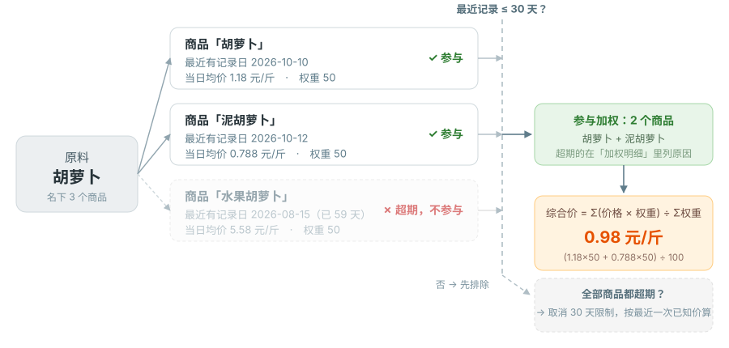

# 核心概念与计算逻辑

这篇讲清生计系统里的关键概念：原料、商品、价格三者什么关系，价格和成本怎么算，"一天"怎么界定，营养怎么标。读懂这篇，功能文档会轻松很多。

> 进阶小节标了"进阶"，普通用户可跳；管理员和较真账的用户建议看。

---

## A. 实体模型：系统怎么理解"吃"

生计用三层实体描述"吃"这件事：

**原料（ingredient）**
烹饪意义上的食材，比如"鸡蛋""茄子"。原料带营养数据、可以分类（层级）、可以被别的原料替代。原料本身不直接记价格——价格记在它挂的商品上。

**商品（product）**
原料在某个/某些商家那里的具体可购买品，比如"某品牌鸡蛋一盒 10 枚"。商品挂靠在原料下，是**价格的载体**。一个原料可以有多个商品（不同品牌/规格，价格可能差很多，比如有机蛋和普通蛋）。

除了区分品牌、规格外，商品也可用于区分可相互替代，而且无显著差别的不同食材。比如说：茄子分紫色的和绿色的，分圆形的和长条状的，而且做菜时通常不会严格要求使用哪种茄子；而这些茄子在超市里又有不同的价格。这种情况下可以将“茄子”作为原料，这些不同的品种作为商品。

**价格记录（ProductRecord）**
一条具体的购买记录：金额、数量、单位、商家、日期、记录类型。记录类型分两类：

- **价格记录**（默认）：用于成本/趋势计算，不计入个人支出
- **支出**（purchase）：作为实际支出计入报告

三者层级关系：

```
原料 ──1:N──> 商品 ──1:N──> 价格记录
（鸡蛋）       （某品牌蛋一盒）   （¥15 / 10个 / 2026-07-01 / 某超市）
```

补充：

- 一个商品可以"拆分为原料"——把它从当前原料里独立出来，成为同名原料（用于某个商品需要单独管理营养/价格时）
- 原料有"默认单位"的概念已迁移到**用户级偏好**（见 [个人中心](profile.md)），原料本身不再有默认单位

---

## B. 原料之间的关系

原料之间有三种关系，都会影响价格和营养的回退：

**层级（parent/child）**
原料的分类树。当某个原料没有自己的价格/营养时，可以沿层级**回退**到父项借用。

层级大多数情况用于总类和分项。比如：猪肉有猪排、里脊、梅花肉、前腿肉、后腿肉等部位。很多菜都明确要求使用特定部位的肉，但是也有很多菜并不要求是什么部位的。这种情况下，可以设置层级：

```text
猪肉 <-- 猪排 <-- 前排、中排、大排……
猪肉 <-- 里脊、梅花肉、前腿肉、后腿肉……
```

这样，如果菜谱中提及了“猪肉”，尽管记录价格时不会把价格记到“猪肉”下，也能够根据这些子原料来计算相应的价格。

**可替代（substitutable）**
两个原料互为替代品（比如"猪肉"和"牛肉"在某菜谱里可互换）。当原料缺价或缺营养时，可替代原料也能作为回退源。

此外还有单向的可替代关系：**可回退**。多用于设置默认的回退方向。比如：上面提到猪肉，如果我绝大多数情况下，猪肉的菜谱都用的是里脊肉，那么我可以设置“猪肉”回退到“里脊”。这样，计算猪肉的价格时（当然这种情况下仍然不会把价格写到“猪肉”里面），用的就是里脊的价格，而不是之前那套层级关系。

**半成品菜谱**
原料可以指向"它的制作菜谱"（带产出重量）。比如原料"米饭"指向菜谱"电饭煲蒸米饭"。当原料没有商品价时，系统会由制作菜谱的成本反推出它的每克单价，支持递归套娃（菜谱的原料又指向另一个半成品），并自动检测循环。

回退链的完整顺序见 [C 节](#c-价格体系)。

## C. 价格体系

### 价格记录

每条记录包含：金额、数量、单位、商家、日期、记录类型。系统按"元/标准单位"归一化存储，便于跨单位比较。

### 两层加权平均

原料的价格不是把所有记录简单平均，而是分两步：

1. **商品内**：每个商品取自己**「最近有记录日」**那天记录的均价（同一天记多条，取这几条的平均）；
   所以某个商品"记了多少条"不会让它分量变重
2. **商品间**：把各商品的价格按**权重（0–100，默认 50）**加权平均

两步之间还有一条**30 天规则**（见下），决定哪些商品"还算数"。



```
原料「胡萝卜」
 ├─ 商品「胡萝卜」      最近记录 10-10   1.18  元/斤 ─┐
 ├─ 商品「泥胡萝卜」    最近记录 10-12   0.788 元/斤 ─┤ 30 天内 → 参与
 └─ 商品「水果胡萝卜」  最近记录 08-15   5.58  元/斤 ─┘ 已 59 天 → 不参与
                        └→ 加权：(1.18×50 + 0.788×50) ÷ (50+50) = 0.98 元/斤
```

权重的设计是为了解决"有机蛋 ¥3/个 vs 普通蛋 ¥0.8/个"这种悬殊——你给常用商品设高权重，原料价就贴近它。

> **重要**：权重只作用于"平均"这一项。同一天的**最高/最低价、记录条数**是记录级的，不受权重影响；
> 但**权重设成 0 会让这个商品整个退出**——不参与平均，也不再出现在"价格区间"和"参与商品数"里（这正是把某个商品排除掉的办法）。

### 30 天规则：久未更新的商品不算，全都久未更新就都算

商品的价格是"记一次、一直有效到下一次记录"。但如果一个商品很久没更新，它的旧价会长期主导原料价——
比如 8 周前记的水果胡萝卜 ¥5.58/斤，会把普通胡萝卜的综合价从 ¥0.98 拉到 ¥2.5 以上，跟你眼前的价格完全对不上。所以：

- 商品的**最近一次记录在 30 天内** → 参与加权
- 超过 30 天 → **不参与**，在"加权明细"里标为「超期未更新（>30 天）」
- **所有商品都超过 30 天** → 取消这条限制，全部按各自最近一次已知价参与，并提示
  「商品价格均超过 30 天未更新，按各自最近一次已知价计算」——宁可显示旧价格，也不能没有价格

30 天与站内其它"陈旧"口径保持一致（商家价的灰显、菜谱食材的价格超期提示）。

### 权重来源

- **全局权重**（`price_weight`）：管理员设置，对所有用户生效
- **我的覆盖**（每个用户自定）：优先于全局。留空则用全局

普通用户只能改自己的覆盖；全局权重只有管理员能改。详见 [原料与商品](ingredients.md#商品加权价格)。

### 原料价回退链

**成本计算**里，某天某个原料没有自己的价格时，按下面的顺序回退（页面上的"综合最新价"**不回退**，没有价格就显示"暂无"）：

1. 该原料自己的商品有价（按上面两层加权）
2. 转向**可替代**原料
3. 转向**层级父项**
4. 由**半成品菜谱**反推

任一环有价就用它，全部失败则该原料当日无价（成本里记为缺价）。

---

## D. 时间与"一天"的口径

生计是**多时区**系统。这里讲清"一天"怎么界定——这点对价格趋势、成本趋势、今日推荐都很关键。

### 存储与传输

- **数据库**：所有时间以 **UTC** 存储（naive datetime）
- **API 响应**：带 `+00:00` 时区标记的 ISO 8601 字符串
- **前端显示**：浏览器自动把 UTC 转成你本地时区显示

### "一天"= 你本地的自然日

系统里所有"把记录归到某一天"的判定，都以**你本地的自然日**（00:00:00 到 23:59:59）为准，统一通过 **`X-Timezone` 请求头**（IANA 时区名，如 `Asia/Shanghai`）传递：

- 前端 axios 拦截器给**每个请求**统一注入 `X-Timezone`
- 后端用 `get_timezone` 依赖校验它（缺失或非法返回 400）
- 默认兜底 UTC（正常流程前端总会带，几乎不触发）

> 如果你在中国（无夏令时），体感和以前一样。如果你在跨时区或夏令时地区，"今天"会准确按你当地算，而不是服务器所在地。

### 趋势的阶梯语义（进阶）

价格趋势、菜谱成本趋势用的是**截至当日的最新价**（术语叫 `as_of` 前向填充）：

- 某天有记录 → 取当天价
- 某天没记录 → 沿用最近一次有记录的价

所以趋势线是**阶梯状**的——价格变动那天才跳，没变的日子沿用前一天。这也意味着"日边界差几小时"几乎不影响趋势数值。

### 支出报告

支出报告按**本地日**汇总当日发生额：你在本地时间 7 月 1 日记的支出，就归到 7 月 1 日，不会因为服务器在别的时区而错位。

---

## E. 聚合与计算逻辑（进阶）

### 最新价

- **商品**：该商品"最近有记录日"那天的均价，折算到你偏好的单位（默认 ¥/斤）
- **原料**：名下各商品的最近价按 [C 节](#c-价格体系) 的两步加权计算（含 30 天规则；全部超期则放开）。
  卡片上的"价格区间 / 商品数"就是参与加权的那几个商品的价格范围与个数；展开"加权明细"能看到每个参与者（含权重来源）和被排除者（含原因）。
  一个原料一个商品都没记过价时，这里显示"暂无"——成本计算另有 [回退链](#原料价回退链)

### 价格趋势

- 按日聚合（**用户本地日**），区间支持 周/月/季/年/全部
- **原料**趋势图的"加权平均"线与上面的原料价同口径：每天取"截至当天仍然有效"的商品价（30 天规则同样生效，全部超期时放开），
  再按权重加权；区间带显示参与加权商品的价格范围
- **商品**趋势图只有一个商品，没有"商品间权重"这一层：平均线就是该商品当天的均价
- 阶梯语义见 [D 节](#趋势的阶梯语义进阶)

### 菜谱成本

每项食材 = **用量 × 单价**，其中"单价"就是原料详情页那套**综合价**（同一口径、同一个 30 天规则）。具体要点：

- 某商品超过 30 天没更新时，默认不再参与该原料的价，除非该原料**所有**商品都超期（那时按最近一次已知价算并提示）——
  所以"很久以前记的高价"不会永久抬高菜谱成本
- 用量单位与计价单位不一致时，按**实体单位覆盖**或**密度**折算（见 [单位与密度](units-density.md)）
- 用量是区间（`quantity_range`）时取平均值
- 半成品菜谱的成本**逐层传递**
- 成本明细会列出参与了哪些商品、价格来源（加权 / 回退 / 名称匹配 / 半成品 / 子食材聚合）与价格记录日期

### 单位换算

- 以 **SI 基准**统一（避免不同单位体系混算出错）
- 体积 ↔ 质量走**密度**（每种原料可单独设密度）
- 兼容市制（斤）、公制（千克/克）、英制

---

## F. 营养计算

### NRV%（营养素参考值百分比）

系统按**中国 GB 标准**计算各营养素的 NRV%，方便你判断"这道菜占了今天多少营养"。

### 能量单位

能量在 **千卡（kcal）** 和 **千焦（kJ）** 之间换算，系数 `×4.184`。你可以在个人中心选偏好的能量单位，系统会自动换算显示。

### 营养数据来源优先级

一个原料的营养数据可能来自多处，系统按优先级取用：

1. **自定义营养**（最优先）
2. **USDA 已验证**（手动匹配 USDA 并标记为已验证的数据）

商品的营养数据走 `custom_nutrition_data`（自定义），原料走 `NutritionData`。详见 [营养分析](nutrition.md)。

---

## G. 数据归属：谁的数据归谁

生计是多用户系统，数据按"桶"分类管理权限。简化理解：

- **私有桶**：你记的价格记录、你的菜谱、你的商家、你的常用地点等——只有你能看（管理员除外）
- **共享桶**：原料、商品、单位、营养、商家共享池等基础库——所有用户共用
- **全局桶**：系统级配置（地图密钥、AI 配置等）

普通用户改共享桶的数据 → 进入**提议-审核**队列，管理员审核后生效；管理员改共享桶 → 直接生效并留痕。这套机制详见 [入门 · 多用户机制](getting-started.md#多用户与提议-审核) 和 [提议审核台](admin/review.md)。

---

读懂这篇之后，你可以按需翻功能手册了。建议从 [入门](getting-started.md) 开始。
