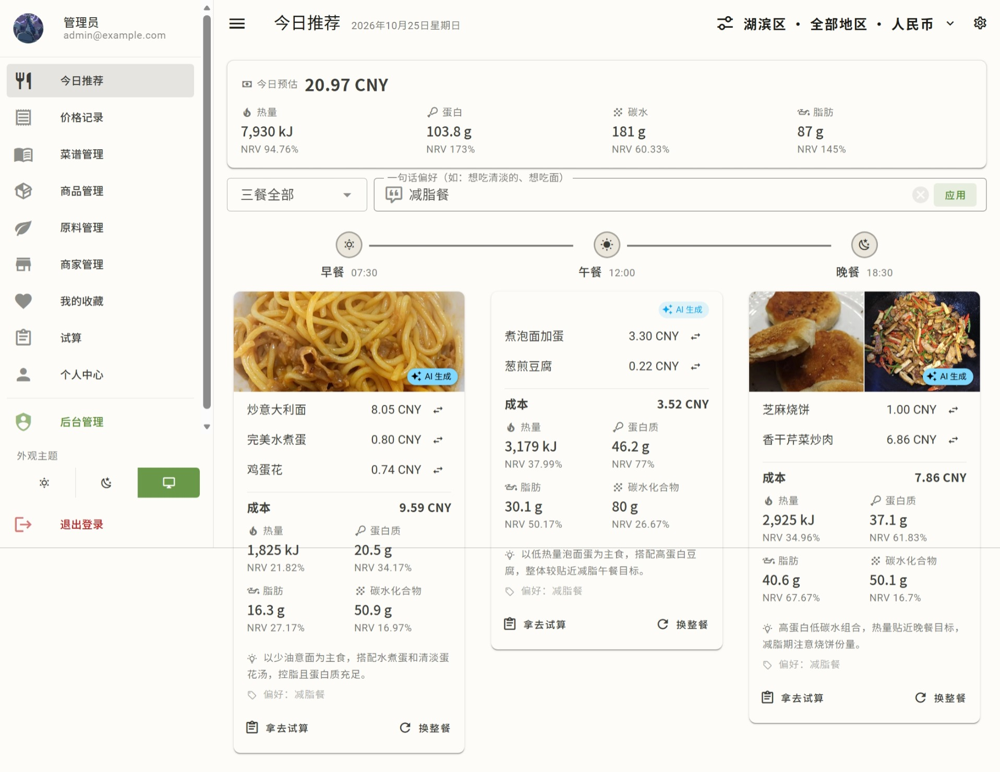

# 今日推荐

生计能根据你的营养目标和预算，每天给你推荐三餐**套餐**（每餐 1-4 道菜，保证有主食）。这篇讲推荐怎么来、怎么换、怎么避过敏原。

## 一餐的构成

打开"今日推荐"页，系统会为你的**早 / 午 / 晚**各组合一餐：

- **每餐 1-4 道菜，至少一道主食**——主食自足的菜（蛋炒饭、番茄鸡蛋面这类）可以单独成餐，配菜数量由搭配决定
- 午 / 晚的候选池：主食、荤菜、素菜、水产、汤与粥；早餐的候选池：早餐、主食、汤与粥（甜品、饮料、调料、半成品不进正餐池）
- 依据：你的**营养目标**、**预算**、**黑名单 / 过敏原**，以及你的**收藏**（收藏的菜谱和含收藏原料的菜会被优先考虑）
- 每餐卡片会给出**推荐理由**；如果标注了"AI 生成"，说明这餐由 AI 组合（见下）
- 页面顶部的当日汇总与每餐卡片合计，都是**一行预估成本 + 营养素 NRV 宫格**（窄屏自动变 2×2）

## 组合方式：AI 优先，规则兜底

候选菜谱先经确定性打分（营养接近目标 + 成本接近预算 + 收藏加权），每个分类取前几名组成**短名单**，再由组合层出套餐：

- **AI 组合**（默认）：把短名单、你的目标和偏好交给配置好的大模型（在 [后台 · AI 与机翻配置](admin/admin-pages.md) 里配置 provider），由它组合套餐并给出理由；输出经过严格校验（必须含主食、只能从短名单选、不得重复），不合格会自动重试一次
- **规则组合**（兜底）：未配置 AI、AI 超时/不可用、或达到每日 AI 次数上限时，自动退回「主食 + 主菜 +（汤）」的规则组合，并如实标注
- **一句话偏好**：推荐页可以输入"今天想吃清淡的""想吃面"这类偏好，随生成 / 换菜提交，当餐快照展示

管理员可以设置全局默认方式、是否允许用户自选、是否允许用户自备密钥（BYOK），以及**每日 AI 次数上限**（超出自动转规则组合）；用户可在个人中心选择自己的方式（详见 [后台管理](admin/admin-pages.md)）。

## 同一道菜不会天天见

- **近 7 天推荐过的菜谱不进候选**（同一道菜跨餐次也只出现一次）；候选不足时自动放宽到 3 天 → 不限制，保证永远有得吃
- 每餐的候选按分类打分取前列，组合层在此范围内挑选——高分大概率入选，低分也有机会

## 换一个 / 换这道

每餐支持两种换法：

- **换整餐**：重新组合整套套餐（排除当前这些菜）
- **换这道**：只替换某一道菜，其余保持不变；换掉的是主食时，新菜也会保证是主食
- **拿去试算**：对推荐的一餐想自己调整？点餐卡上的「拿去试算」，把这套搭配带进[试算](planner.md)页增删改，改完可一键**设为今日**（见 [试算 · 与今日推荐联动](planner.md#与今日推荐联动)）

- 每餐每天两种换法**共享 5 次**刷新上限
- 超出后提示"明天再来"

## 黑名单 / 过敏原

你在 [个人中心 · 原料黑名单](profile.md#原料黑名单) 设的黑名单原料，会从候选菜谱池里排除——含黑名单原料的菜谱不会被推荐给你（已生成的推荐若命中黑名单，会自动后台重搭）。过敏原分组由管理员维护（见 [后台管理 · 原料黑名单分组](admin/admin-pages.md#原料黑名单分组)），你可以在个人中心整组加入黑名单。

如果所有候选菜谱都命中黑名单，会提示你调整黑名单范围。

## 当天缓存与"今天"

- 当天已生成的推荐会**缓存**，不会每次刷新都重算
- "今天"按你的**本地日**界定（见 [核心概念 · 一天](concepts.md#d-时间与一天的口径)）——你在东八区的"今天"和在美国的"今天"不一样，系统按你本地算
- 跨过本地午夜后自动进入第二天，重新生成
- 想立即换当餐就点"换整餐"或"换这道"

## 生成不出推荐？

- **候选菜谱池为空**：正餐分类（主食 / 荤菜 / 素菜 / 水产 / 汤与粥 / 早餐）的菜谱太少，多加几个
- **所有候选都命中黑名单**：提示你调整黑名单范围
- **营养目标/预算未设**：去 [个人中心](profile.md) 设一下（不设也有默认值）
