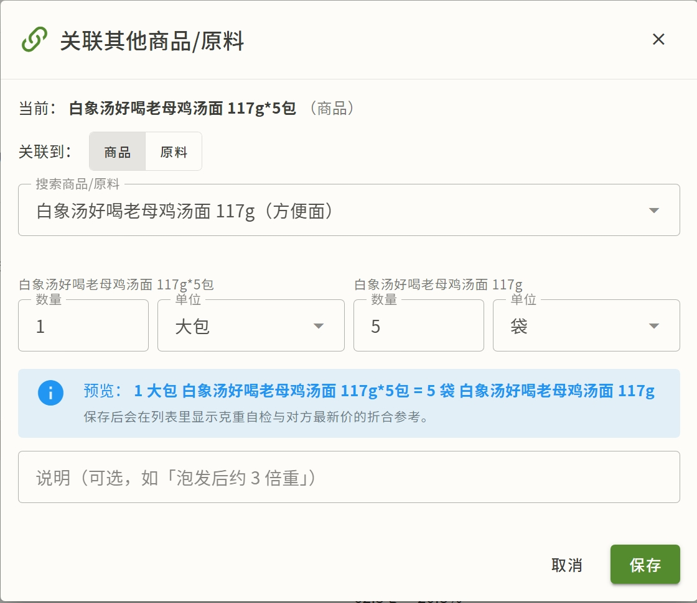

# 单位与密度

生计支持公制、市制（斤）、英制多套单位，还要在体积和质量之间换算。这篇讲单位怎么管、密度怎么设。

## 单位系统

- **多体系并存**：公制（千克、克、升、毫升）、市制（斤）、英制等
- **SI 基准统一**：内部以 SI 基准换算，避免不同体系混算出错
- **能量**：kcal 与 kJ 并存，按你的偏好显示（见 [个人中心](profile.md)）

你的单位偏好在**个人中心**设置（能量/质量/体积/价格各一个）。设好后全系统按偏好显示。

## 单位管理

系统维护一个**标准单位列表**（千克、克、斤、升、毫升、个等）。单位本身属于共享数据：

- 管理员可以新增、修改、删除单位（走提议-审核的"管理员直写"）
- **标准单位**（千克、克等基准单位）不可改基准，也不能删——动基准会破坏所有历史换算
- 单位的换算关系（如 1 斤 = 500 克）维护在单位表里

**自定义单位**：除标准单位外，还能为具体原料/商品定义自定义单位（如「袋」「提」），指定它折多少标准量，支持**嵌套引用**（1 箱 = 12 盒，1 盒 = 250 g）。在实体详情页的「单位与密度」卡里维护；价格、菜谱用量、营养基准都能直接用这些单位。

## 实体单位覆盖

有些单位对**特定原料/商品**有特殊换算。比如"个"对鸡蛋可能是 50 克、对苹果可能是 200 克。这种"实体级"的特殊换算叫**实体单位覆盖**（`entity_unit_overrides`）：

- 为某原料或商品设"这个单位 = 多少标准量"
- 没设则用单位表的默认换算
- 改动走提议-审核（共享数据）

> 这在成本计算里很关键：菜谱写"鸡蛋 2 个"，系统需要知道 2 个鸡蛋折多少克，才能和商品价（¥/斤）相乘。

## 密度

体积 ↔ 质量的换算靠**密度**（`entity_densities`）。每种原料可以单独设密度：

- 单位可在 **g/cm³** 和 **kg/m³** 之间切换（默认 g/cm³）
- 比如油的密度约 0.92 g/cm³，水是 1 g/cm³
- 没设密度的原料，体积 ↔ 质量换算无法进行

密度改动走提议-审核。

> 为什么要密度：某菜谱写"油 50 毫升"，商品价是"¥/斤"。要把毫升折成克/斤，就需要油的密度。

## 关联与换算

实体单位覆盖解决的是"**同一个单位**对特定实体多重"，**关联与换算**解决的是"**两个实体之间**的数量等式"：

- **两两等式**：形如 `1 提 = 12 包`（商品 ↔ 商品）、`1 提 = 1 箱`（商品 ↔ 原料），两端各带数量与单位，可附备注
- 原料之间的干 / 鲜折算（`1 kg 干香菇 = 3 kg 鲜香菇`）建在**层级 / 替代关系的换算系数**上，不建在这里
- 建立后：
  - 单位换算可以**沿等式折克**（提 → 包 → 箱 → g 串起来换算）
  - 原料没有直接价时，成本计算能用关联方的价格按等式**折算**（价格来源标为「关联换算」），进入 [回退链](concepts.md#c-价格体系) 的第二环
- 维护入口在商品 / 原料详情页的**「单位与密度」卡**：每条等式有克重自检（两端各折多少克）和对方最新价折合参考；商品页只读展示其挂靠原料的关联
- **删除 / 合并**有关联的实体前，需要先解除其关联

## 改/删（审核差异）

实体单位覆盖、密度、关联与换算都属于**共享数据**，改动按角色分流：

| 角色 | 改/删 | 生效 |
|---|---|---|
| 普通用户 | 提议-审核 | 管理员审核通过后生效 |
| 管理员 | 直接生效 | 立即，留痕 |

都支持审核台回滚。详见 [提议审核台](admin/review.md)。
